# UAV Identification: New Breakthrough in Anti-UAV Technology: Ultra High Precision Drone Classification with Noise Robust Radio Frequency Signal Preprocessing Method [with Python Code]

New breakthrough in anti-drone technology: Preprocessing method for noise-resistant radio frequency signals achieves ultra-high precision drone classification
Abstract: Following the outbreak of COVID-19, the demand for drones has surged due to their remote and contactless applications. However, the malicious use of drones has also become increasingly prominent, necessitating the development of anti-drone systems to detect unauthorized drones. This study proposes an RF-based drone recognition scheme, utilizing 15 types of drone controller signals for research. It addresses the issue of poor classification accuracy in traditional RF detection methods when the distance between the controller and the antenna increases or the signal-to-noise ratio (SNR) decreases. In experiments, Gaussian white noise was added to adjust the SNR of the controller signals within a range of -15 to 15 dB with a step size of 5 dB. Convolutional neural network training was conducted using power spectral plots with applied thresholds. The model achieved a classification accuracy of 98% at an SNR of -15 dB and achieved a precision of 99.17% across 105 categories formed by 15 types of drone controllers across seven SNR intervals, verifying the proposed method's duality in noise resistance and scalability.
Currently, data sources for drone detection and classification mainly include radar, audio, visual, and radio frequency signals. However, all three have significant drawbacks: radar is difficult to detect small drones with low radar cross section and low-altitude drones, and it can easily mistake birds for drones; audio detection has extremely short detection distances and is highly sensitive to environmental noise; visual detection is greatly affected by fog, weather conditions, and obstacles, and requires high-resolution cameras and line-of-sight conditions. In contrast, radio frequency detection is more reliable and performs better, making it a focal point of research.
Current research on RF-based unmanned aerial vehicle (UAV) classification often integrates feature extraction, machine learning, and deep learning techniques. Some studies also utilize spectral graphs and convolutional neural networks to enhance accuracy. However, these studies have not considered scenarios with low signal-to-noise ratios, nor have they addressed the issue of abruptly declining classification accuracy under low SNR conditions. To address this, this study proposes a noise-resistant classification method. By thresholding the data preprocessing of the spectral graph after power spectral density transformation, high-precision classification can be achieved under low SNR conditions. The study uses the UAV remote control RF signal dataset published by the IEEE Data Port to classify 15 different UAV controllers and compares it with other studies using the same dataset, validating the superiority of the method.
Method Overview: This study's radio frequency-based unmanned aerial vehicle (UAV) classification method revolves around three core processes: signal processing, spectral graph generation, and convolutional neural network training. The overall system consists of an UAV, controller, antenna, high-resolution oscilloscope, and computer. It accomplishes identification by intercepting the radio frequency signals between the UAV and the controller. The specific steps are as follows:
1  
Noise Addition and Signal Separation: To simulate a low signal-to-noise ratio environment, Gaussian white noise is added to the 15 collected UAV controller radio frequency signals, adjusting the signal-to-noise ratio to -15~15 dB (with a step of 5 dB). The method of mean change point detection is used to separate the noise and effective components in the signal. The signal power is calculated and corresponding Gaussian white noise with the target signal-to-noise ratio is generated, which is then superimposed on the original signal.
2  
Power Spectral Plot Generation and Threshold Preprocessing: First, the time-domain signal is converted into a spectral plot based on Power Spectral Density (PSD) through Short-Time Fourier Transform. Then, it is transformed into a power-based spectral plot, and thresholds are calculated from the power spectrum and applied to the power-based spectral plot. Noise interference is filtered by replacing values below the threshold with the threshold, achieving clear separation of signals from noise and addressing the issue of color bias in traditional PSD-based spectral plots that leads to decreased classification accuracy in Convolutional Neural Networks.
3  
Lightweight CNN Model Training: Design a lightweight convolutional neural network (CNN) consisting of three two-dimensional convolutional layers and three max pooling layers, using a thresholded power spectral density plot as input. The model is trained using a stochastic gradient descent optimizer and the cross-entropy loss function, with only 0.485M parameters learned, balancing classification accuracy with real-time performance.
Performance Verification Experiments: Conduct two sets of experiments: one comparing the classification accuracy between PSD and power spectral density plots under different signal-to-noise ratios, and another validating the method's scalability by combining 15 controllers with 7 noise levels into 105 categories.
Conclusion: This study proposes a data preprocessing technique for drone controller radio frequency signals used in drone recognition. By adding Gaussian white noise to the raw signal to create various signal-to-noise ratio environments, it abandons traditional PSD spectral density plots and employs power spectral density plots for model training. It also combines the threshold calculation from power spectrum to preprocess the spectral plot, effectively reducing the impact of noise on classification. At a signal-to-noise ratio as low as -15 dB, the method still achieves over 98% drone controller classification accuracy, and reaches an accuracy of 99.17% in the classification task of 105 categories (15 controllers × 7 noise levels), fully verifying its excellent noise resistance and scalability.
This research provides a more precise method for drone radio frequency classification based on spectral graphs, which is expected to promote the performance improvement of anti-drone systems. However, the classification of multiple drone controller signals remains challenging at present. Future research will focus on multi-signal classification at the physical signal level, striving to achieve real-time drone detection similar to radar.

## Images

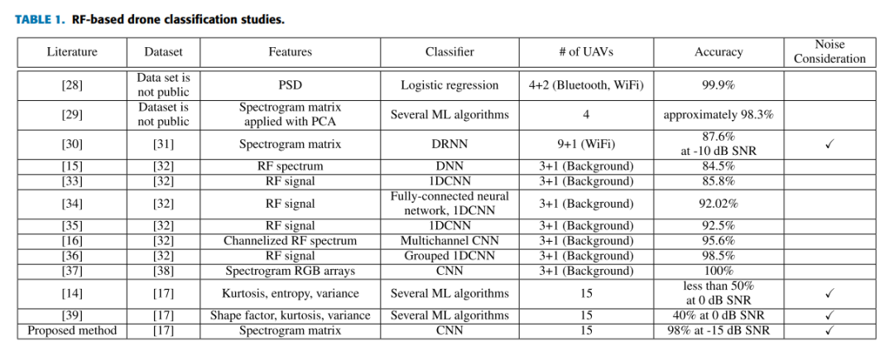
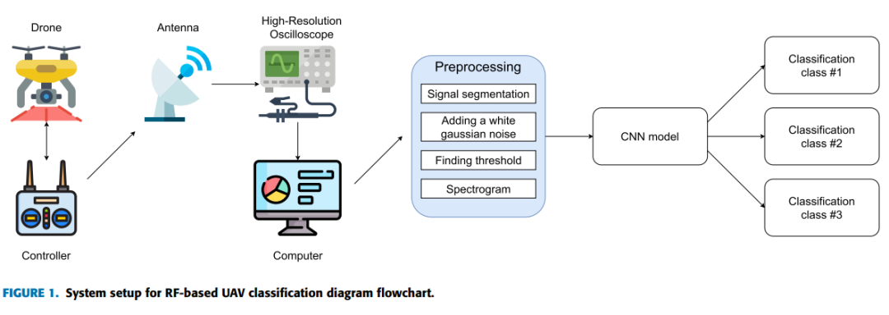
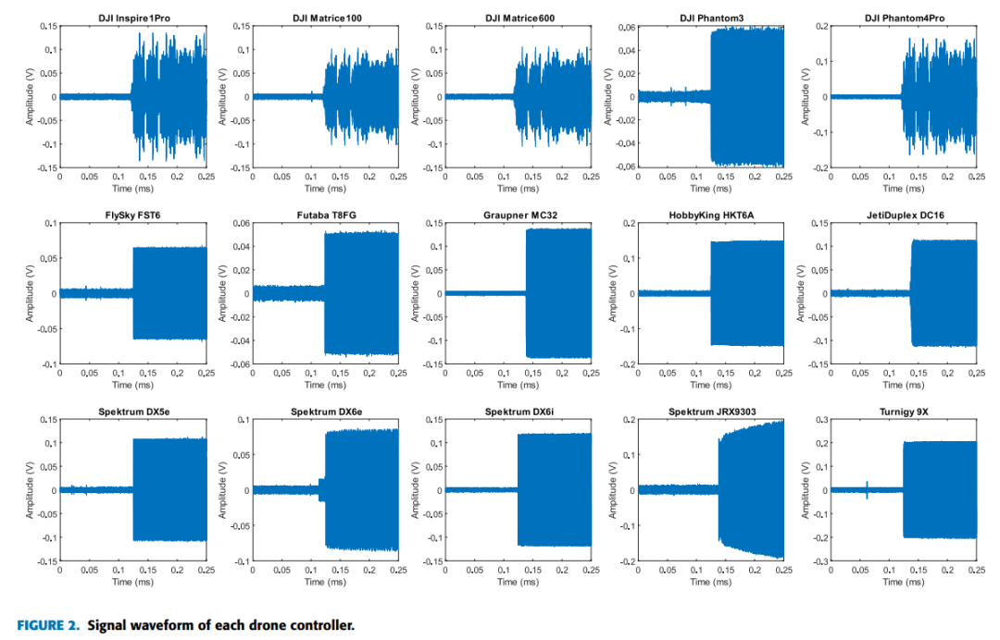
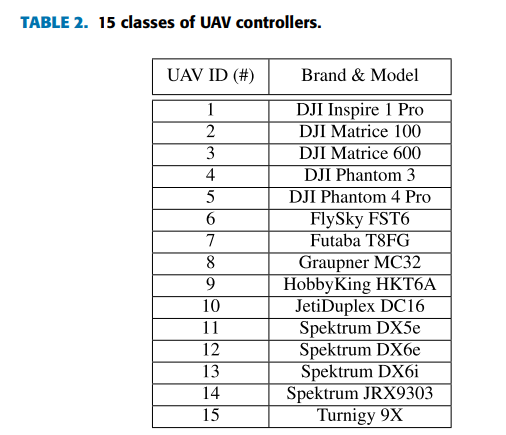
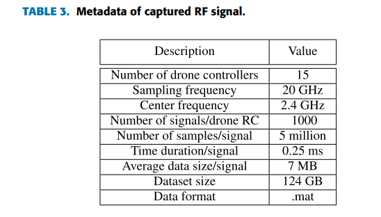
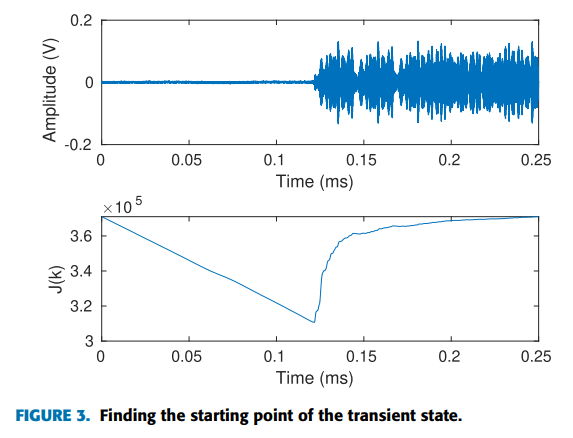
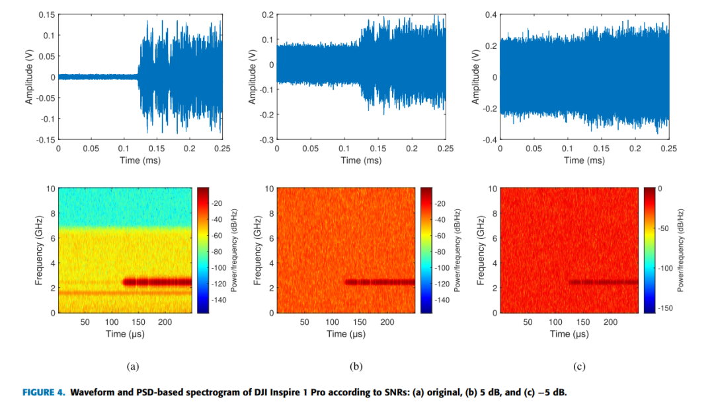
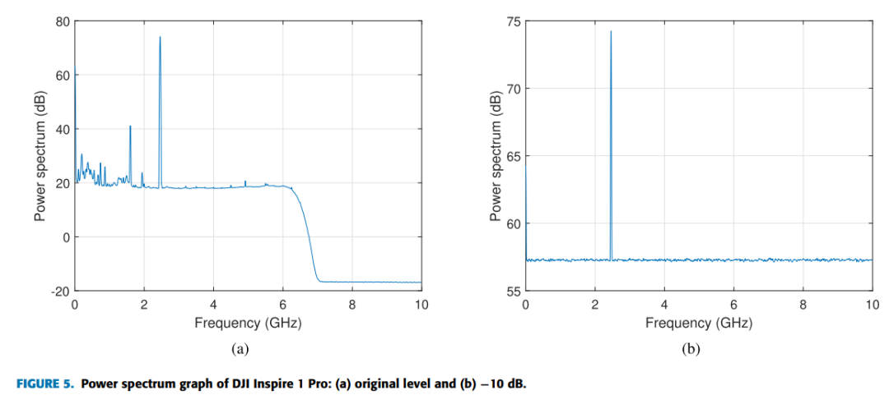
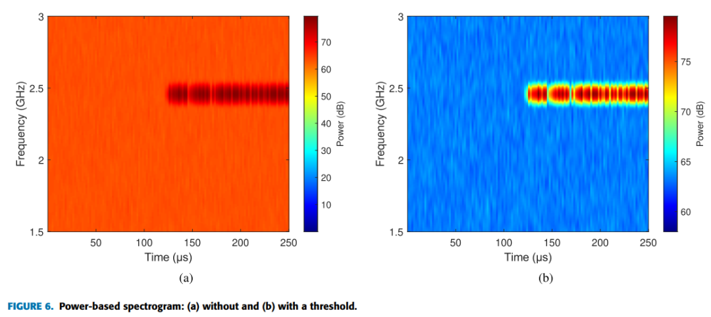
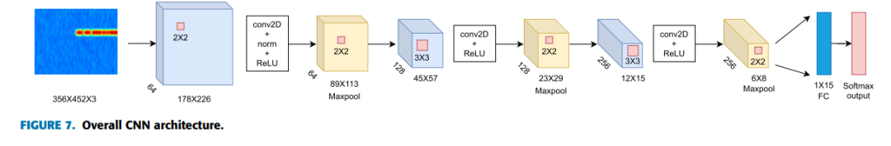
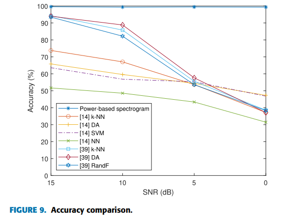

<!-- PAYMENT_BLOCK -->

## Get this dataset

- Payment link (Stripe): [Buy now](https://buy.stripe.com/3cs8yP7sY87d0vu9AB)
- Payment QR code: 

<!-- /PAYMENT_BLOCK -->
